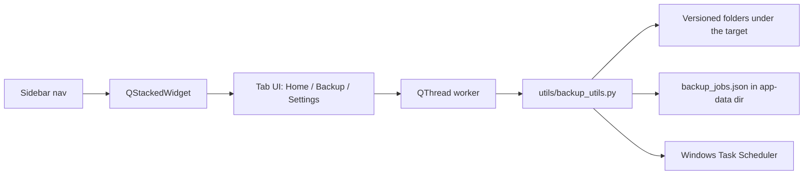

<div align="center">

# Safekeep

**Versioned, scheduled folder backups with restore, in one offline desktop app.**

[](LICENSE)
[](https://github.com/TechCabana/utility-tool)
[](#)
[](https://github.com/TechCabana/utility-tool/commits/main)

[Overview](#overview) ·
[Installation](#installation) ·
[Architecture](#architecture) ·
[Testing](#testing) ·
[Contributing & Licence](#contributing--licence)

</div>

---

> **TL;DR:** Safekeep is a PySide6 desktop app for one job: backing folders up. A backup
> job copies a source folder into a new timestamped version under a target folder, keeps the
> last few versions, can be scheduled through Windows Task Scheduler, and restores a version
> into a new folder. The app runs fully offline.

## Overview

| | |
| --- | --- |
| **Status** | Maintenance (feature-complete, fixes only) |
| **Stack** | Python 3.9+, PySide6 (Qt) |
| **Hosting** | None; runs locally as a desktop app |
| **License** | MIT |
| **Live** | Not applicable, no hosted deployment |

### Goal

One desktop tool that keeps copies of the folders that matter on another drive, and gets
them back. The image, file and disk-cleanup tools this app used to carry were removed so
backup is the only job it does. "Finished" means a backup runs reliably offline against
local folders, with real progress feedback, and a stored version can be restored.

### Scope

| In scope | Not in scope |
| --- | --- |
| Backup jobs: one source folder copied into a new timestamped version folder under a target on every run | Cloud targets, accounts, sync, or any network access |
| Keeping the last N versions per job and deleting older ones | Block-level or disk-image backups |
| Scheduling a job daily or weekly through Windows Task Scheduler; a scheduled run opens no window | macOS scheduling is written but has never run on a Mac |
| A Restore table showing each job's last backup and how much has changed since | Restoring over the live source folder; a restore always lands in a new folder |
| Windows and macOS, run from source or packaged with PyInstaller | An installer/updater; PyInstaller output is a raw binary only |

---

## Installation

### Prerequisites

| Requirement | Version | Notes |
| --- | --- | --- |
| Python | 3.9+ | Only interpreter this was built against |
| pip | Any recent | Installs the two pinned dependencies |

### 1. Clone

```bash
git clone https://github.com/TechCabana/utility-tool.git
cd utility-tool
```

### 2. Install

```bash
python -m venv venv
# macOS/Linux
source venv/bin/activate
# Windows (PowerShell)
.\venv\Scripts\activate

pip install -r requirements.txt
```

Installs `PySide6==6.7.2`. Also installs `pytest==9.1.1`, listed in the same flat
`requirements.txt` since no dev/prod split convention exists in this repo yet.

### 3. Run

```bash
python main.py
```

A light-themed window opens with a sidebar and three tabs: Home, Backup, Settings. The window title bar, sidebar header and every other surface in the app go by
"Safekeep" (one word).

### 4. Verify

Run the automated suite (`pytest tests/`, see [Testing](#testing)), then confirm the install
worked by checking that the window opens, the light Soft Rose stylesheet is applied (not the
plain OS default), and all three sidebar tabs switch pages when clicked.

### 5. Configure

No environment variables or secrets are needed. Backup jobs are written to an OS-specific
per-user directory (`utils/fs_utils.py`, function `app_dir()`):

| Platform | Location |
| --- | --- |
| Windows | `%APPDATA%\Safekeep\backup_jobs.json` |
| macOS | `~/Library/Application Support/Safekeep/backup_jobs.json` |
| Linux | `~/.config/Safekeep/backup_jobs.json` |

Nothing here is committed to the repo, and nothing needs to be.

**Upgrading from UtilityTool.** Safekeep was called UtilityTool before. On first start it copies
everything from the old app-data folder (`%APPDATA%\UtilityTool` and its macOS/Linux
equivalents) into the new one, never overwriting a file already there, and leaves the old folder
in place as a safety copy. It also re-registers each scheduled job as `Safekeep_Backup_<id>` and
deletes the old `UtilityTool_Backup_<id>` task only once the new one has registered; if that
fails, the old task keeps running and the app says so. Settings (theme, last tab) carry over too.
The logic is in `utils/migrate.py`.

### Everyday use

| Task | Command |
| --- | --- |
| Run from source | `python main.py` |
| Build a standalone binary | See [Building a standalone binary](#building-a-standalone-binary) below |

### Building a standalone binary

`pyinstaller --onefile --windowed main.py` alone does **not** bundle `assets/` or `styles/`
(confirmed against a real build, which reported "Copying 0 resources to EXE") — the resulting
binary launches with no theme, no bundled font and no icon. Pass `--add-data` for both
directories; the separator between source and destination differs by OS (`;` on Windows, `:`
everywhere else).

```bash
pip install pyinstaller
```

**Windows (PowerShell or cmd):**

```powershell
pyinstaller --onefile --windowed --name "Safekeep" `
  --add-data "styles;styles" `
  --add-data "assets;assets" `
  main.py
```

Writes `dist\Safekeep.exe`. The local `Safekeep.spec` (gitignored by `*.spec`) carries the
same settings: `python -m PyInstaller --noconfirm --clean Safekeep.spec`.

**macOS (or Linux):**

```bash
pyinstaller --onefile --windowed --name "Safekeep" \
  --add-data "styles:styles" \
  --add-data "assets:assets" \
  main.py
```

Writes `dist/Safekeep.app` on macOS, or a plain `dist/Safekeep` executable on Linux.

The packaged binary is unsigned on both platforms — see
[If it does not work](#if-it-does-not-work) for the SmartScreen/Gatekeeper warnings this
triggers and the one-time workaround for each. Windows Task Scheduler entries created by the
Backup screen point at the interpreter and script path used at job-creation time; re-create backup
jobs after switching from running-from-source to a packaged binary so the scheduled task
invokes the right thing.

### If it does not work

| Symptom | Cause | Fix |
| --- | --- | --- |
| Window opens with no theme styling | `styles/theme.qss.tmpl` failed to load | Paths are resolved next to `main.py`, so the working directory does not matter; check the console for a `[WARN] Could not load stylesheet` line and that `styles/` was not moved |
| Text renders in a system font, not Manrope | The bundled `.ttf` files under `assets/fonts/` are missing | Check the console for `[WARN] Could not load font`; restore `assets/fonts/` from the repo |
| A packaged binary is missing its font, icon or theme | `pyinstaller --onefile` alone does not bundle `assets/`, `styles/` or `widgets/` (confirmed against a real build, which reported "Copying 0 resources to EXE") | Add `--add-data` flags (or a `.spec` file) for `assets`, `styles` and `widgets` before packaging for distribution; running from source is unaffected |
| Windows taskbar shows the Python interpreter icon, not the app icon | `setWindowIcon()` sets the title-bar icon only; Windows groups taskbar icons by process, which needs an explicit AppUserModelID or a packaged binary | Cosmetic only: package with PyInstaller, or set an AppUserModelID before opening the window, to fix the taskbar icon specifically |
| Windows shows "Windows protected your PC" (SmartScreen) when running the packaged `.exe` | The binary isn't code-signed (see below) | Click "More info", then "Run anyway" |
| macOS says the app "is damaged and can't be opened" / prompts to move it to the Trash (Gatekeeper) | The binary isn't code-signed or notarized (see below) | Right-click (or Control-click) the app, choose "Open", then confirm "Open" in the dialog that appears. This is a one-time step per machine — it tells Gatekeeper to trust this specific app going forward |

**Why these warnings appear:** this is a personal, single-developer tool, and no Apple
Developer account or Windows code-signing certificate has been purchased for it — both cost
money on an ongoing basis, for a tool built primarily for its own developer to use. The OS has
no way to vouch for an unsigned binary, so it warns by default; that warning is not a sign of
malware, just of an indie tool that hasn't paid for a certificate.

---

## Architecture

### Tools and technologies


| Layer | Choice | Why this one |
| --- | --- | --- |
| Language | Python 3.9+ | Same language on both target OSes, minimal setup for a personal tool |
| UI toolkit | PySide6 (Qt for Python) | Native-feeling cross-platform desktop widgets, QSS for theming |
| Storage | JSON file in the OS app-data directory | No database needed for a handful of backup jobs |
| Packaging | PyInstaller `--onefile` | Measured against Nuitka onefile on this app: 47 MB / 2.9s cold start vs. 80 MB / 3.1s and a more fragile toolchain (see the decision table below) |
| Hosting | None (local desktop app) | Nothing to deploy or serve |
| Automation | None | No CI configured; see [Testing](#testing) |
| Testing | pytest, `utils/` only | See [Testing](#testing); the Qt-driven `tabs/` layer stays manually verified |

### How the pieces fit



<!-- ASCII fallback:
```
  Sidebar nav -> QStackedWidget -> Tab UI -> QThread worker -> utils/backup_utils.py -> version folders
                                                                                    \-> backup_jobs.json, Task Scheduler
```
-->

### End to end walk-through

1. `main.py` builds `MainWindow`, registers the bundled Manrope and Geist Mono fonts, builds the sheet from `styles/theme.qss.tmpl`,
   and mounts three tabs (Home, Backup, Settings) into a `QStackedWidget` switched by the
   sidebar buttons.
2. In `tabs/backup_tab.py`, the user adds a job (name, source, target, schedule, versions to
   keep). Saving it writes `backup_jobs.json` and registers a Windows scheduled task whose
   action is `main.py --run-backup-job <id>`, a headless path that opens no window.
3. Run Now, Restore and the changes-since measurement each start a `QThread` running
   `BackupWorker`, which calls the pure functions in `utils/backup_utils.py` and emits progress
   signals the tab renders as a progress bar.
4. A run first checks it can succeed (pre-flight: source present and non-empty, target not
   inside the source, enough free space, the same target drive as before), then copies the
   source into `<target>/<job id>/<timestamp>.partial/`, hashing every file into a
   `<timestamp>.manifest.jsonl` beside it. Every copied file is re-read and checked against
   the manifest before the folder is renamed to `<timestamp>/`; a mismatch fails the run and
   prunes nothing. Versions beyond the number kept are then pruned, but the newest verified
   version is never deleted. A restore copies the latest version into a new folder the user picks; it
   never writes over the live source.

<details>
<summary><b>Why this approach, and what was rejected</b></summary>

| Decision | Alternative considered | Why the choice was made |
| --- | --- | --- |
| Desktop GUI (PySide6/Qt) | A local web app (Flask + JS) | Reads and writes local files directly with no browser file-access restrictions |
| PyInstaller `--onefile` | Nuitka onefile | Measured 2026-09-08 on a real build: PyInstaller came in at 47 MB / 2.9s cold start against Nuitka's 80 MB / 3.1s, plus a more fragile toolchain (an auto-downloaded MinGW compiler, one outright build failure). Worse on every axis measured |
| Per-operation `QThread` workers | Running backup work on the UI thread | Keeps the window responsive during a large batch and gives real progress bars instead of a frozen UI |
| Backup jobs as a JSON file in the OS app-data directory | A bundled SQLite database, or jobs inside the repo | No database dependency for a handful of records, and survives an app reinstall since it lives outside the repo |

</details>

<details>
<summary><b>Data model</b></summary>

One JSON file (`backup_jobs.json`) holding a list of jobs, in the shape
`utils/backup_utils.new_job()` creates:

```json
[
  {
    "id": "d6ffa43b",
    "name": "Documents nightly",
    "source": "C:\\Users\\me\\Documents",
    "target": "E:\\Backups",
    "schedule": "daily",
    "at": "20:00",
    "retention": 5,
    "target_volume": "1754806083",
    "last_run": "2026-11-02T20:00:04",
    "last_result": "ok"
  }
]
```

| Field | Type | Notes |
| --- | --- | --- |
| `id` | string | Eight hex characters; versions live under `<target>/<id>/`, so renaming a job never orphans its history |
| `schedule` | string | `manual`, `daily` or `weekly` |
| `at` | string | 24-hour run time, `HH:MM` |
| `retention` | int | Versions to keep; older ones are deleted after a run |
| `target_volume` | string | The target drive's volume id, recorded on save or first run; a run onto a different drive is refused |

The file is replaced atomically on every save, and the previous good copy is kept as
`backup_jobs.json.bak`. A damaged file is reported as damaged, never read as "no jobs"; the
Backup screen offers to restore the `.bak`, and the headless `--run-backup-job` path exits 3.
| `last_result` | string | `ok`, or `failed: <message>` |

</details>

<details>
<summary><b>Project structure</b></summary>

```
utility-tool/
├── main.py               app entry point; window shell, sidebar, tab wiring, headless --run-backup-job path
├── requirements.txt      pinned dependencies (PySide6, pytest)
├── LICENSE                MIT
├── assets/
│   ├── icon.png           window/taskbar app mark
│   ├── fonts/             Manrope + Geist Mono (SIL OFL 1.1) + OFL texts
│   └── icons/             Lucide SVG subset (ISC) + LICENSE
├── styles/
│   ├── tokens.py          Colour, type scale, spacing, motion - the one source
│   └── theme.qss.tmpl     Stylesheet template, built from tokens.py per theme
├── tabs/                  one QWidget per sidebar page
│   ├── home_tab.py         entry card to Backup + recent activity
│   ├── backup_tab.py       backup jobs table, Restore table, job dialog, worker thread
│   └── settings_tab.py     appearance (theme) and about
├── widgets/               reusable Qt widgets shared across tabs
│   ├── common.py           page header, card, ConfirmDialog, EmptyState
│   ├── icons.py            SVG -> QIcon, recoloured per theme
│   └── motion.py           the one fade, reduced-motion aware
├── utils/                 pure logic, no Qt imports
│   ├── backup_utils.py     jobs storage, versioned copy, restore, changes-since, Task Scheduler
│   ├── activity.py         short log of recent runs shown on Home
│   ├── fs_utils.py         app-data path, symlink/junction test, byte formatting
│   └── migrate.py          one-time copy of data, tasks and settings from the UtilityTool name
└── tests/                 pytest suite over utils/ and styles/ (Qt-free layer only, see Testing)
    ├── test_backup_utils.py
    ├── test_activity.py
    ├── test_fs_utils.py
    ├── test_jobs_file.py
    ├── test_migrate.py
    ├── test_preflight.py
    ├── test_tokens.py
    └── test_verify.py
```

| Path | Role |
| --- | --- |
| `main.py` | Composes the window, sidebar and tabs; registers the bundled fonts, then loads the QSS theme |
| `assets/` | App icon, the bundled Manrope + Geist Mono typefaces and the Lucide icon set. The app makes no network calls, so the UI font ships as `.ttf` files and is registered by `load_fonts()` before the stylesheet is applied. Naming a font in the QSS without a file here silently falls back to a system face. Not yet included in a PyInstaller `--onefile` build; see [If it does not work](#if-it-does-not-work) |
| `tabs/` | UI for each sidebar page, one file per tab |
| `widgets/` | Shared Qt widgets (dialogs, empty states, icons) reused across tabs |
| `utils/` | Framework-free helpers the tabs call into; safe to unit test in isolation |
| `styles/theme.qss` | The only styling, apart from card drop shadows (`apply_card_shadows` in `main.py`, since QSS has no `box-shadow`) and a few label-level inline styles |

</details>

---

## Testing

```bash
pytest tests/
```

Covers the Qt-free layer only (`utils/backup_utils.py`, `utils/activity.py`,
`utils/fs_utils.py`, `utils/migrate.py` and the design tokens in `styles/tokens.py`), using real `tmp_path` files;
the scheduler, free space and volume identity are injected rather than touched. 163 tests,
all passing. The Qt-driven `tabs/` layer (including the Backup screen's
worker thread and UI) has no automated coverage and stays manually
verified, per the [Verify](#4-verify) and [If it does not work](#if-it-does-not-work) steps
above.

---

## Contributing & Licence

### Contributing

Issues and pull requests are welcome. Open an issue before starting anything large, so the
approach can be agreed first. Commits follow
[Conventional Commits](https://www.conventionalcommits.org/en/v1.0.0/), and work lands on
`main` through a pull request.

### Licence

Released under the MIT licence. The full text is in [LICENSE](LICENSE), and it covers the
code in this repository only.

### Credits and third-party terms

- UI built on [PySide6](https://doc.qt.io/qtforpython-6/), LGPLv3 licensed (Qt for Python).
- UI typeface is [Manrope](https://github.com/sharanda/manrope), copyright 2018 The Manrope Project Authors, and the data typeface is [Geist Mono](https://vercel.com/font), copyright 2024 The Geist Project Authors,
  used under the SIL Open Font License 1.1. The font files are redistributed in
  `assets/fonts/` with the licence text at
  [`assets/fonts/OFL.txt`](assets/fonts/OFL.txt); the MIT licence above does not cover them.

---

<div align="center">

<sub>Built and maintained by <a href="https://github.com/TechCabana">TechCabana</a></sub>

</div>
