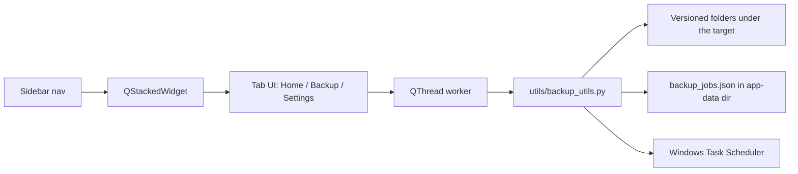

<div align="center">

# Safekeep

**Versioned, scheduled folder backups with restore, in one offline desktop app.**

[](LICENSE)
[](https://github.com/TechCabana/utility-tool)
[](#)
[](https://github.com/TechCabana/utility-tool/commits/main)

[Overview](#overview) ·
[Installation](#installation) ·
[What a backup keeps](#what-a-backup-keeps-and-what-a-check-proves) ·
[Architecture](#architecture) ·
[Testing](#testing) ·
[Contributing & Licence](#contributing--licence)

</div>

---

> **TL;DR:** Safekeep is a PySide6 desktop app for one job: backing folders up. A backup
> job copies a source folder into a new timestamped version under a target folder, keeps the
> last few versions, can be scheduled through Windows Task Scheduler, and restores a version
> into a new folder. The app runs fully offline.

## Overview

| | |
| --- | --- |
| **Status** | Maintenance (feature-complete, fixes only) |
| **Stack** | Python 3.9+, PySide6 (Qt) |
| **Hosting** | None; runs locally as a desktop app |
| **License** | MIT |
| **Live** | Not applicable, no hosted deployment |

### Goal

One desktop tool that keeps copies of the folders that matter on another drive, and gets
them back. The image, file and disk-cleanup tools this app used to carry were removed so
backup is the only job it does. "Finished" means a backup runs reliably offline against
local folders, with real progress feedback, and a stored version can be restored.

### Scope

| In scope | Not in scope |
| --- | --- |
| Backup jobs: one source folder copied into a new timestamped version folder under a target on every run | Cloud targets, accounts, sync, or any network access |
| Keeping the last N versions per job and deleting older ones | Block-level or disk-image backups |
| Scheduling a job daily or weekly through Windows Task Scheduler; a scheduled run opens no window | macOS scheduling is written but has never run on a Mac |
| A Restore table showing each job's last backup and how much has changed since | Restoring over the live source folder; a restore always lands in a new folder |
| Windows and macOS, run from source or packaged with PyInstaller | An installer/updater; PyInstaller output is a raw binary only |

---

## Installation

### Prerequisites

| Requirement | Version | Notes |
| --- | --- | --- |
| Python | 3.9+ | Only interpreter this was built against |
| pip | Any recent | Installs the two pinned dependencies |

### 1. Clone

```bash
git clone https://github.com/TechCabana/utility-tool.git
cd utility-tool
```

### 2. Install

```bash
python -m venv venv
# macOS/Linux
source venv/bin/activate
# Windows (PowerShell)
.\venv\Scripts\activate

pip install -r requirements.txt
```

Installs `PySide6==6.7.2`. Also installs `pytest==9.1.1`, listed in the same flat
`requirements.txt` since no dev/prod split convention exists in this repo yet.

### 3. Run

```bash
python main.py
```

A light-themed window opens with a sidebar and three tabs: Home, Backup, Settings. The window title bar, sidebar header and every other surface in the app go by
"Safekeep" (one word).

### 4. Verify

Run the automated suite (`pytest tests/`, see [Testing](#testing)), then confirm the install
worked by checking that the window opens, the light Soft Rose stylesheet is applied (not the
plain OS default), and all three sidebar tabs switch pages when clicked.

### 5. Configure

No environment variables or secrets are needed. Backup jobs are written to an OS-specific
per-user directory (`utils/fs_utils.py`, function `app_dir()`):

| Platform | Location |
| --- | --- |
| Windows | `%APPDATA%\Safekeep\backup_jobs.json` |
| macOS | `~/Library/Application Support/Safekeep/backup_jobs.json` |
| Linux | `~/.config/Safekeep/backup_jobs.json` |

Nothing here is committed to the repo, and nothing needs to be.

**Upgrading from UtilityTool.** Safekeep was called UtilityTool before. On first start it copies
everything from the old app-data folder (`%APPDATA%\UtilityTool` and its macOS/Linux
equivalents) into the new one, never overwriting a file already there, and leaves the old folder
in place as a safety copy. It also re-registers each scheduled job as `Safekeep_Backup_<id>` and
deletes the old `UtilityTool_Backup_<id>` task only once the new one has registered; if that
fails, the old task keeps running and the app says so. Settings (theme, last tab) carry over too.
The logic is in `utils/migrate.py`.

### Everyday use

| Task | Command |
| --- | --- |
| Run from source | `python main.py` |
| Build a standalone binary | See [Building a standalone binary](#building-a-standalone-binary) below |

### Building a standalone binary

`pyinstaller --onefile --windowed main.py` alone does **not** bundle `assets/` or `styles/`
(confirmed against a real build, which reported "Copying 0 resources to EXE") — the resulting
binary launches with no theme, no bundled font and no icon. Pass `--add-data` for both
directories; the separator between source and destination differs by OS (`;` on Windows, `:`
everywhere else).

```bash
pip install pyinstaller
```

**Windows (PowerShell or cmd):**

```powershell
pyinstaller --onefile --windowed --name "Safekeep" `
  --add-data "styles;styles" `
  --add-data "assets;assets" `
  main.py
```

Writes `dist\Safekeep.exe`. The local `Safekeep.spec` (gitignored by `*.spec`) carries the
same settings: `python -m PyInstaller --noconfirm --clean Safekeep.spec`.

**macOS (or Linux):**

```bash
pyinstaller --onefile --windowed --name "Safekeep" \
  --add-data "styles:styles" \
  --add-data "assets:assets" \
  main.py
```

Writes `dist/Safekeep.app` on macOS, or a plain `dist/Safekeep` executable on Linux.

The packaged binary is unsigned on both platforms — see
[If it does not work](#if-it-does-not-work) for the SmartScreen/Gatekeeper warnings this
triggers and the one-time workaround for each. Windows Task Scheduler entries created by the
Backup screen point at the interpreter and script path used at job-creation time; re-create backup
jobs after switching from running-from-source to a packaged binary so the scheduled task
invokes the right thing.

### If it does not work

| Symptom | Cause | Fix |
| --- | --- | --- |
| Window opens with no theme styling | `styles/theme.qss.tmpl` failed to load | Paths are resolved next to `main.py`, so the working directory does not matter; check the console for a `[WARN] Could not load stylesheet` line and that `styles/` was not moved |
| Text renders in a system font, not Manrope | The bundled `.ttf` files under `assets/fonts/` are missing | Check the console for `[WARN] Could not load font`; restore `assets/fonts/` from the repo |
| A packaged binary is missing its font, icon or theme | `pyinstaller --onefile` alone does not bundle `assets/`, `styles/` or `widgets/` (confirmed against a real build, which reported "Copying 0 resources to EXE") | Add `--add-data` flags (or a `.spec` file) for `assets`, `styles` and `widgets` before packaging for distribution; running from source is unaffected |
| Windows taskbar shows the Python interpreter icon, not the app icon | `setWindowIcon()` sets the title-bar icon only; Windows groups taskbar icons by process, which needs an explicit AppUserModelID or a packaged binary | Cosmetic only: package with PyInstaller, or set an AppUserModelID before opening the window, to fix the taskbar icon specifically |
| Windows shows "Windows protected your PC" (SmartScreen) when running the packaged `.exe` | The binary isn't code-signed (see below) | Click "More info", then "Run anyway" |
| macOS says the app "is damaged and can't be opened" / prompts to move it to the Trash (Gatekeeper) | The binary isn't code-signed or notarized (see below) | Right-click (or Control-click) the app, choose "Open", then confirm "Open" in the dialog that appears. This is a one-time step per machine — it tells Gatekeeper to trust this specific app going forward |

**Why these warnings appear:** this is a personal, single-developer tool, and no Apple
Developer account or Windows code-signing certificate has been purchased for it — both cost
money on an ongoing basis, for a tool built primarily for its own developer to use. The OS has
no way to vouch for an unsigned binary, so it warns by default; that warning is not a sign of
malware, just of an indie tool that hasn't paid for a certificate.

---

## What a backup keeps, and what a check proves

**What is copied.** Every ordinary file under the source folder, with its modified time. On
Windows the hidden, system, archive and read-only marks are kept too, so a hidden file is still
hidden after a restore. Two things are left out. Alternate data streams are not backed up: these
are the extra data Windows can attach to a file, such as the "downloaded from the internet" mark
(`Zone.Identifier`), so a restored file does not carry that mark. Symbolic links and junctions
(shortcuts to a folder or file somewhere else) are not followed, so what they point to is not in
the backup, and they are named instead of dropped without a word: the job reads "OK, N
shortcuts not followed" (with the skipped and changed counts first when there are any), its
Status tooltip lists up to five of them, a run's message says, for example, "2 shortcut
folders point somewhere else and were not followed: Archive, Photos. Add those locations as
their own backup", and the headless run prints a `[WARN]` line to stderr (exit code
unchanged). Windows' own profile junctions (`My Documents`, `Application Data` and the like,
which Windows marks hidden and system and which point back into the same profile) are not
counted; a junction you made yourself is counted even when it has one of those names.

**Stored files are marked read-only.** Once a backup is finished its files and its checksum
list are marked read-only (on macOS and Linux the write permission is dropped), so an accidental
save or script is refused, which protects against accidents but not against someone who clears
the mark on purpose, and a restored file is an ordinary writable file unless the original was
read-only; backups made by earlier versions are not marked.

**Version names use local time; their order does not.** A version is named for the computer's
clock when its backup started, for example `20261025-013000`. When the clocks go back in
autumn, one hour happens twice, so a backup made later can carry an earlier name than one made
before it. Safekeep therefore does not order backups by name. Each backup's checksum list ends
with the UTC time the backup finished, and Restore's default choice, the clean-up that keeps
only the last few versions, the newest-verified-copy rule, the file-count comparison that holds
back a clean-up and the "changes since" figure all use that time. The names and folders are
unchanged. A backup made before this change has no recorded time, so those are ordered by name
and counted as older than any backup that has one; the old mix-up can therefore still happen
for two of those made inside the same repeated hour, and for a backup whose checksum list has
since been damaged. A run never deletes the backup it has just made, whatever its name.

**What the check proves.** While it copies, Safekeep records a SHA-256 checksum of each file,
taken from the bytes it actually read from the source. Before a new version is kept, the job's
Verification setting (under Advanced in the job form) decides how the copy is checked:

- **Full** (the default) re-reads every copied file from the backup drive and compares its size
  and checksum with the record, and confirms every file on the record is there.
- **Quick** checks the size of every file and re-reads a sample (about 5%, at most 500 files,
  always including the largest and the most recently changed one).
- **Off** checks nothing. The version is kept but marked "not verified", and it never counts as
  the last known-good copy.

A failed check fails the run: nothing is pruned and earlier backups are left as they were. A
passing Full check means every file that was copied is on the backup drive with the bytes
Safekeep read. It does not mean:

- **Every source file is in the backup.** A file that cannot be read, such as one another
  program has locked, is tried once more at the end of the copy and then skipped. The job reads
  "OK, N skipped" instead of "OK", and its Status tooltip gives the count and up to five names.
  If more than 30% of the files (and at least three) could not be copied, the run fails instead.
- **The source stood still.** Safekeep does not take a snapshot. After copying each file it
  looks at the source again, and a file whose size or modified time is not what it was before
  the copy changed underneath the read, so it is copied once more. If it changed again, that
  second copy is kept and the file is marked in the checksum list; the job then reads "OK, N
  changed during backup" (with the skipped count first when there is one, for example "OK, 1
  skipped, 1 changed during backup") and its Status tooltip names up to five of the files.
  The check still only confirms that the copy matches what was read, so a marked file may mix
  old and new parts: close the program using it and back up again. A change that leaves both
  the size and the modified time as they were is not seen, and a snapshot of the source
  (Windows shadow copy) is planned, not built.
- **The backup stays intact.** The check runs once, right after the copy, and its re-read can
  be answered from the computer's memory rather than the disk. Nothing re-checks stored versions
  later, so bit rot on the backup drive goes unnoticed until you restore; a scheduled deeper
  check is not built yet. A restore does compare each file it copies against the record and
  names any that do not match.
- **You can restore it.** Nothing yet restores a sample to prove a backup can be brought back;
  a test restore is planned, not built.

**An interrupted run is not resumed.** If the power goes or the program is killed part-way
through a run, Safekeep does not pick the copy up where it stopped. The half-finished copy is
never treated as a version, the job's Status reads "Interrupted: started ... and never
finished", and the next run starts again from the beginning. A backup drive that is unplugged
mid-run is a failed run instead, reported with its cause, and the next run likewise starts
over. Closing the app while a backup runs cancels it: the half-finished copy is removed and the
job reads "Failed" (its result is "Backup cancelled"), not "Interrupted". A close that comes
after the copy was checked and kept, while older versions are being removed, waits for that
step to finish and records the backup as made.

---

## Architecture

### Tools and technologies


| Layer | Choice | Why this one |
| --- | --- | --- |
| Language | Python 3.9+ | Same language on both target OSes, minimal setup for a personal tool |
| UI toolkit | PySide6 (Qt for Python) | Native-feeling cross-platform desktop widgets, QSS for theming |
| Storage | JSON file in the OS app-data directory | No database needed for a handful of backup jobs |
| Packaging | PyInstaller `--onefile` | Measured against Nuitka onefile on this app: 47 MB / 2.9s cold start vs. 80 MB / 3.1s and a more fragile toolchain (see the decision table below) |
| Hosting | None (local desktop app) | Nothing to deploy or serve |
| Automation | None | No CI configured; see [Testing](#testing) |
| Testing | pytest, `utils/` only | See [Testing](#testing); the Qt-driven `tabs/` layer stays manually verified |

### How the pieces fit



<!-- ASCII fallback:
```
  Sidebar nav -> QStackedWidget -> Tab UI -> QThread worker -> utils/backup_utils.py -> version folders
                                                                                    \-> backup_jobs.json, Task Scheduler
```
-->

### End to end walk-through

1. `main.py` builds `MainWindow`, registers the bundled Manrope and Geist Mono fonts, builds the sheet from `styles/theme.qss.tmpl`,
   and mounts three tabs (Home, Backup, Settings) into a `QStackedWidget` switched by the
   sidebar buttons.
2. In `tabs/backup_tab.py`, the user adds a job (name, source, target, schedule, versions to
   keep). Saving it writes `backup_jobs.json` and registers a Windows scheduled task whose
   action is `main.py --run-backup-job <id>`, a headless path that opens no window.
3. Run Now, Restore and the changes-since measurement each start a `QThread` running
   `BackupWorker`, which calls the pure functions in `utils/backup_utils.py` and emits progress
   signals the tab renders as a progress bar.
4. A run first checks it can succeed (pre-flight: source present and non-empty, target not
   inside the source, enough free space, the same target drive as before), then copies the
   source into `<target>/<job id>/<timestamp>.partial/`, hashing every file into a
   `<timestamp>.manifest.jsonl` beside it (one line per file with its path, size, modified time
   and SHA-256, plus `"changed": true` for a file still changing on its second copy and
   `"ro": true` when the source file was read-only; the last line records the file and byte
   counts, the check mode and result, `finished_utc`, the UTC time versions are ordered by, and
   `"protected": true`, meaning the version's files were marked read-only and restore takes each
   file's read-only state from `ro`). By default every copied file is re-read and checked
   against the manifest before the folder is renamed to `<timestamp>/`; a mismatch fails the
   run and prunes nothing. Each job can instead use a quick check (every file's size, plus the
   hashes of a sample of at most 500 files) or no check at all; a version made with the check
   off is kept but marked "not verified" and never counts as the last known-good copy.
   Versions beyond the number kept are then pruned, but the newest verified version is never
   deleted. A restore copies the newest verified version into a new folder the user picks,
   and asks first when a newer version was never verified or when none is; it never writes
   over the live source.
5. A run that cannot finish honestly fails instead of saving a partial copy: if the backup
   drive fills up, disappears or refuses a write, or the source folder disappears, or at least
   three files and more than 30% of them cannot be read, or nothing at all could be copied,
   nothing is promoted or pruned and earlier versions are left as they were. A file that cannot
   be read at first (often one another program has locked) gets one more try once the rest of
   the tree is copied; if it still cannot be read it is skipped and counted in the result, and
   the job then reads "OK, N skipped" rather than plain OK. A file that changed while it
   was being copied is copied once more (that is its one extra attempt, in total); one that
   is still changing is kept and counted separately, and the job reads "OK, N changed during
   backup". A run that copied more
   than 30% fewer files than the largest version still kept (verified or not) succeeds and
   keeps that larger version aside ("pruning held") while the others are pruned as usual, so
   an emptied source cannot roll the last complete copy out of retention and a source that
   stays smaller costs one extra version, not unbounded growth. The hold ends when the count
   recovers, or when the owner says the shrink was expected ("This is expected: forget the
   larger backup" on the job, or `main.py --release-hold <id>`); a failed run does not clear
   it, and a low-space failure says it is in force.
   Every run appends one line to `logs/<job id>.jsonl` in the
   app-data folder (the newest 200 are kept). Only one run of a job happens at a time (a lock file in the app-data folder); a
   second one, such as the scheduled task firing during a manual run, is refused and the
   headless path exits 4. Abandoned leftovers of failed runs older than 7 days are removed at
   the start of the next run, except the most recent one, which is kept for inspection.
6. The headless entry points and their exit codes:

   | Command | Exit codes |
   | --- | --- |
   | `main.py --run-backup-job <id>` | 0 ok, 1 failed, 2 no such job, 3 jobs file damaged, 4 already running |
   | `main.py --precheck-job <id>` | 0 nothing to fix, 5 any problem found (even files that would only be skipped), 2 no such job, 3 jobs file damaged |
   | `main.py --release-hold <id>` | 0 released or nothing to release, 1 could not be saved, 2 no such job, 3 jobs file damaged, 4 job is running |

   A job's first unattended run, if it was never checked, is pre-checked once it holds the
   job's lock; the check only warns and never stops the run.

<details>
<summary><b>Why this approach, and what was rejected</b></summary>

| Decision | Alternative considered | Why the choice was made |
| --- | --- | --- |
| Desktop GUI (PySide6/Qt) | A local web app (Flask + JS) | Reads and writes local files directly with no browser file-access restrictions |
| PyInstaller `--onefile` | Nuitka onefile | Measured 2026-09-08 on a real build: PyInstaller came in at 47 MB / 2.9s cold start against Nuitka's 80 MB / 3.1s, plus a more fragile toolchain (an auto-downloaded MinGW compiler, one outright build failure). Worse on every axis measured |
| Per-operation `QThread` workers | Running backup work on the UI thread | Keeps the window responsive during a large batch and gives real progress bars instead of a frozen UI |
| Backup jobs as a JSON file in the OS app-data directory | A bundled SQLite database, or jobs inside the repo | No database dependency for a handful of records, and survives an app reinstall since it lives outside the repo |

</details>

<details>
<summary><b>Data model</b></summary>

One JSON file (`backup_jobs.json`) holding a list of jobs, in the shape
`utils/backup_utils.new_job()` creates:

```json
[
  {
    "id": "d6ffa43b",
    "name": "Documents nightly",
    "source": "C:\\Users\\me\\Documents",
    "target": "E:\\Backups",
    "schedule": "daily",
    "at": "20:00",
    "retention": 5,
    "target_volume": "1754806083",
    "verify": "full",
    "last_run": "2026-11-02T20:00:04",
    "last_result": "ok",
    "last_skipped": 0,
    "last_skipped_sample": [],
    "last_changed": 0,
    "last_changed_sample": [],
    "last_links": 0,
    "last_links_sample": [],
    "last_pruning_held": false,
    "last_baseline_files": 0,
    "last_files": 1204
  }
]
```

| Field | Type | Notes |
| --- | --- | --- |
| `id` | string | Eight hex characters; versions live under `<target>/<id>/`, so renaming a job never orphans its history |
| `schedule` | string | `manual`, `daily` or `weekly` |
| `at` | string | 24-hour run time, `HH:MM` |
| `retention` | int | Versions to keep; older ones are deleted after a run |
| `target_volume` | string | The target drive's volume id, recorded on save or first run; a run onto a different drive is refused |
| `verify` | string | `full` (default: re-read every copied file), `quick` (all sizes, a sample of hashes) or `off`; a missing or unknown value runs as `full` |
| `last_result` | string | The last run's real outcome: `ok`, `ok_skipped`, `ok_changed`, `ok_links` or `ok_pruning_held` (all successes; a run that left several things behind stores the highest-ranked one: pruning held, then skipped, changed, shortcuts), `failed: <message>`, or `interrupted: started <time> and never finished` (a run that began and was killed or crashed before it recorded a result; `last_run` is then when it began). The word is the headline; `last_skipped`, `last_changed`, `last_links` and `last_pruning_held` below carry every count and name. Jobs saved by older builds hold a plain `ok` beside those fields and display the same |
| `running` | object | Present only while a run is under way, or after one died: `{since, pid, start_time, stamp, token}`, written just before copying and removed when the run records its outcome. A marker whose process is gone is shown as "Interrupted" and recorded as `interrupted` in `last_result` and the run log. Do not edit it by hand |
| `last_skipped`, `last_skipped_sample` | int, list | Files the last run could not read, and up to five of their names; 0 and empty after a clean or a failed run |
| `last_changed`, `last_changed_sample` | int, list | Files the last run kept although they were still changing while they were copied (marked `"changed": true` in the checksum list), and up to five of their paths from the source root; 0 and empty after a clean or a failed run |
| `last_links`, `last_links_sample` | int, list | Shortcuts (symbolic links and junctions) the last run did not follow, so what they point to is not in its version, and up to five of their paths from the source root (never the place they point to); 0 and empty after a run with none, or a failed run |
| `last_pruning_held`, `last_baseline_files`, `last_files` | bool, int, int | Whether the last successful run kept a larger older version aside, that version's file count, and how many files it copied; a failed run leaves all three unchanged |
| `last_finished_utc` | string | When the last successful run finished, in UTC (`2026-10-25T01:45:12Z`), the same value as the end of its checksum list; absent until a job has a successful run made by a version that records it, and a failed run leaves it unchanged |
| `last_precheck` | object | The last pre-check's summary: `{time, ok, aborted, fs, scanned, problems, blocking, counts, sample}` (counts by kind, up to five paths from the source root). Absent until a job is first checked |
| `hold_released` | object | Present after the owner released a pruning hold: `{stamp, files, level, since, time}`, the version let go and its file count, the source's file count then, and the newest version at that moment. Versions older than `since` no longer count as the larger backup to compare with |

The file is replaced atomically on every save, and the previous good copy is kept as
`backup_jobs.json.bak`. A damaged file is reported as damaged, never read as "no jobs"; the
Backup screen offers to restore the `.bak`, and the headless `--run-backup-job` path exits 3.
A jobs file written by an older version (without the skipped, changed and hold fields) reads
as "nothing skipped, nothing changed, nothing held".

</details>

<details>
<summary><b>Project structure</b></summary>

```
utility-tool/
├── main.py               app entry point; window shell, sidebar, tab wiring, headless --run-backup-job / --precheck-job / --release-hold paths
├── requirements.txt      pinned dependencies (PySide6, pytest)
├── LICENSE                MIT
├── assets/
│   ├── icon.png           window/taskbar app mark
│   ├── fonts/             Manrope + Geist Mono (SIL OFL 1.1) + OFL texts
│   └── icons/             Lucide SVG subset (ISC) + LICENSE
├── styles/
│   ├── tokens.py          Colour, type scale, spacing, motion - the one source
│   └── theme.qss.tmpl     Stylesheet template, built from tokens.py per theme
├── tabs/                  one QWidget per sidebar page
│   ├── home_tab.py         entry card to Backup + recent activity
│   ├── backup_tab.py       backup jobs table, Restore table, job dialog, worker thread
│   └── settings_tab.py     appearance (theme) and about
├── widgets/               reusable Qt widgets shared across tabs
│   ├── common.py           page header, card, ConfirmDialog, EmptyState
│   ├── icons.py            SVG -> QIcon, recoloured per theme
│   └── motion.py           the one fade, reduced-motion aware
├── utils/                 pure logic, no Qt imports
│   ├── backup_utils.py     facade: re-exports the backup modules below under one import
│   ├── jobs_store.py       jobs file, its .bak and lock, job CRUD, record_run
│   ├── versions.py         version names, manifests, prune, sweep of leftovers, restore
│   ├── copying.py          tree walk, hashing copy, copy_tree and its failure types
│   ├── verify.py           full and quick checks of a finished copy
│   ├── preflight.py        pre-run checks (source, target, same drive, space)
│   ├── precheck.py         read-only check of every file the target cannot hold
│   ├── runner.py           run_job and changes-since
│   ├── runlog.py           per-job run log, one JSON line per run, newest 200 kept
│   ├── scheduler.py        Windows Task Scheduler and macOS launchd registration
│   ├── activity.py         short log of recent runs shown on Home
│   ├── fs_utils.py         app-data path, symlink/junction test, byte formatting
│   ├── locks.py            cross-process lock files: one run per job, one writer of the jobs file
│   └── migrate.py          one-time copy of data, tasks and settings from the UtilityTool name
└── tests/                 pytest suite over utils/ and styles/ (Qt-free layer only, see Testing)
    ├── conftest.py         keeps every test's jobs file, locks and run logs out of the real app-data folder; clears read-only marks under the temp folder when the session ends
    ├── helpers.py          clears or reads the read-only mark on files inside finished versions
    ├── test_backup_utils.py
    ├── test_activity.py
    ├── test_changed_during_copy.py
    ├── test_clock_change.py
    ├── test_close_midrun.py
    ├── close_midrun_child.py   not a test: the real app, closed mid-run, as a child process of test_close_midrun.py
    ├── test_edit_keeps_run_state.py
    ├── test_empty_job_list.py
    ├── test_fs_utils.py
    ├── test_interrupted_run.py
    ├── test_jobs_file.py
    ├── test_links_not_followed.py
    ├── test_lock_start_time.py
    ├── test_locks.py
    ├── test_long_paths.py
    ├── test_migrate.py
    ├── test_precheck.py
    ├── test_preflight.py
    ├── test_read_only_versions.py
    ├── test_release_hold.py
    ├── test_restore_candidates.py
    ├── test_restore_check.py
    ├── test_retry_skipped.py
    ├── test_review_gate_batch2.py
    ├── test_runlog.py
    ├── test_sanity_guard.py
    ├── test_skipped_status.py
    ├── test_source_vanishes.py
    ├── test_sweep.py
    ├── test_target_failures.py
    ├── test_tokens.py
    ├── test_utc_order.py
    ├── test_verify.py
    └── test_verify_modes.py
```

| Path | Role |
| --- | --- |
| `main.py` | Composes the window, sidebar and tabs; registers the bundled fonts, then loads the QSS theme |
| `assets/` | App icon, the bundled Manrope + Geist Mono typefaces and the Lucide icon set. The app makes no network calls, so the UI font ships as `.ttf` files and is registered by `load_fonts()` before the stylesheet is applied. Naming a font in the QSS without a file here silently falls back to a system face. Not yet included in a PyInstaller `--onefile` build; see [If it does not work](#if-it-does-not-work) |
| `tabs/` | UI for each sidebar page, one file per tab |
| `widgets/` | Shared Qt widgets (dialogs, empty states, icons) reused across tabs |
| `utils/` | Framework-free helpers the tabs call into; safe to unit test in isolation |
| `styles/theme.qss` | The only styling, apart from card drop shadows (`apply_card_shadows` in `main.py`, since QSS has no `box-shadow`) and a few label-level inline styles |

</details>

---

## Testing

```bash
pytest tests/
```

Covers mainly the Qt-free layer (`utils/backup_utils.py` and the modules it re-exports, `utils/precheck.py`, `utils/runlog.py`, `utils/locks.py`, `utils/activity.py`,
`utils/fs_utils.py`, `utils/migrate.py` and the design tokens in `styles/tokens.py`), using real `tmp_path` files;
the scheduler, free space and volume identity are injected rather than touched. Over 700 tests,
all passing; the run takes about four minutes, since several tests wait a second for a distinct version stamp and some start real processes. A few tests drive parts of the Backup screen offscreen (its pre-check, release and interrupted-run paths), but most of the Qt-driven `tabs/` layer (including the Backup screen's
worker thread and UI) has no automated coverage and stays manually
verified, per the [Verify](#4-verify) and [If it does not work](#if-it-does-not-work) steps
above.

---

## Contributing & Licence

### Contributing

Issues and pull requests are welcome. Open an issue before starting anything large, so the
approach can be agreed first. Commits follow
[Conventional Commits](https://www.conventionalcommits.org/en/v1.0.0/), and work lands on
`main` through a pull request.

### Licence

Released under the MIT licence. The full text is in [LICENSE](LICENSE), and it covers the
code in this repository only.

### Credits and third-party terms

- UI built on [PySide6](https://doc.qt.io/qtforpython-6/), LGPLv3 licensed (Qt for Python).
- UI typeface is [Manrope](https://github.com/sharanda/manrope), copyright 2018 The Manrope Project Authors, and the data typeface is [Geist Mono](https://vercel.com/font), copyright 2024 The Geist Project Authors,
  used under the SIL Open Font License 1.1. The font files are redistributed in
  `assets/fonts/` with the licence text at
  [`assets/fonts/OFL.txt`](assets/fonts/OFL.txt); the MIT licence above does not cover them.

---

<div align="center">

<sub>Built and maintained by <a href="https://github.com/TechCabana">TechCabana</a></sub>

</div>
